```{r setup, include = FALSE}
# The app cannot run while the vignette is built, so its code is shown but not
# evaluated; the screenshots in figures/ were taken from the running app with
# scripts/R/make_user_guide_screenshots.R (Sick-Sicker model, default seed).
knitr::opts_chunk$set(collapse = TRUE, comment = "#>", out.width = "100%")
```

This guide is for someone opening ShinyCEA for the first time. It explains
what the app does, then walks through a complete analysis of the bundled
Sick-Sicker model, from launching the app in R to exporting the code.

## What the App Does 

ShinyCEA is an R package with a point-and-click app for **cost-effectiveness
analysis (CEA)**: comparing the costs and health effects (QALYs) of several
strategies to decide which one gives the best value. You give it a decision
model; the app runs the analyses and draws the tables and figures.

| Analysis | Tab | Question it answers |
|:---|:---|:---|
| Base case | Deterministic | Which strategy is best at the expected parameter values? Which are dominated? |
| One- and two-way sensitivity | Deterministic | Which parameters move the result most? |
| Threshold | Threshold | At what value of a parameter does the decision change? |
| Probabilistic (PSA) | PSA, PSA Parameters | How uncertain are costs and QALYs when all parameters vary together? |
| Acceptability and expected loss | CEAC | How likely is each strategy to be cost-effective, and how much is lost by choosing wrongly? |
| Value of information | VOI | What is it worth to reduce uncertainty, and for which parameters? |
| Model behaviour | Survival, Traces | How does the cohort move through the health states? |
| Scenarios and subgroups | Scenarios, Subgroups | Do results hold under other assumptions or patient groups? |
| Weighted comparators | Weighted | How do mixes of strategies (e.g. market shares) compare? |
| Budget impact | BIA | What does adopting a strategy cost the payer over the next years? |
| Equity | Equity | How are health gains distributed across groups? |
| Checks | Health, Validation | Are the parameters and model outputs sound? |
| Reporting | Study | Is the study described well enough to report (CHEERS 2022)? |

## The Example: Sick-Sicker

The Sick-Sicker model is a 4-state Markov cohort model. People start
**Healthy**, can become **Sick**, then **Sicker**, and can die from any state.
It compares standard care (`std`) with four treatments (`t1` to `t4`) that
differ in their effect on progression and mortality and in their drug cost,
over 10 years in 3-month cycles.

## Step 1: Launch the App from R

Install the package once, then load it and start the app with the model:

```{r launch, eval = FALSE}
# install.packages("pak")
pak::pak("CarlosPiant/ShinyCEA")

library(ShinyCEA)
run_cea_app(cea_sick_sicker())
```

`run_cea_app()` with no arguments opens all bundled example models with a
model selector; pass your own model to analyse it instead (see
`vignette("custom-models")`).

The app opens in your browser on the **Model Info** tab, which describes the
model and shows its diagram:

```{r, echo = FALSE, fig.alt = "The app after launch: sidebar on the left, Model Info tab with the parameter dictionary on the right"}
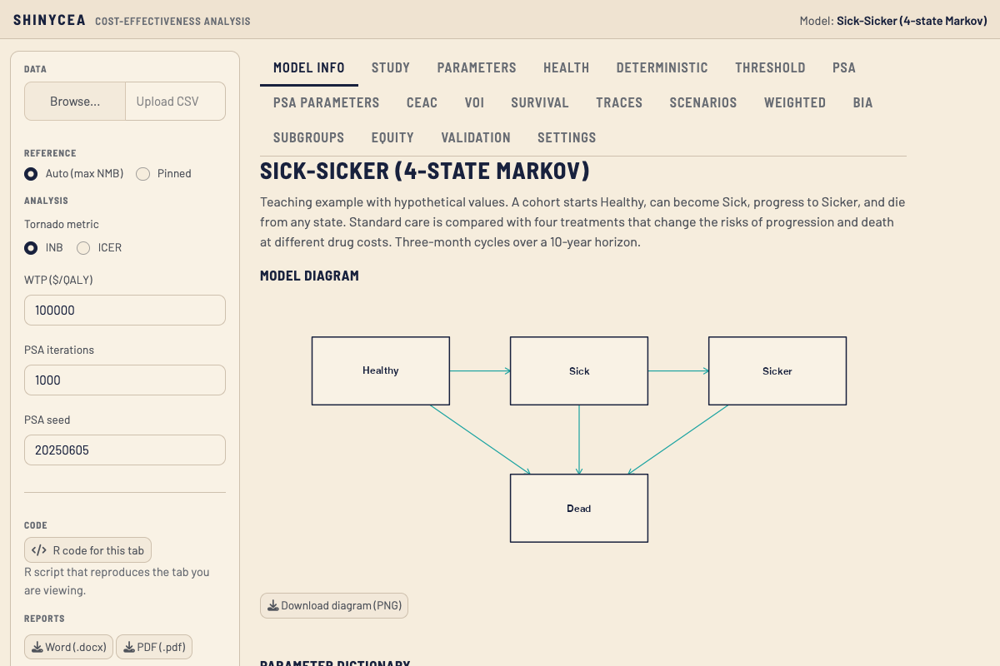
```

The **sidebar** on the left holds the settings shared by all analyses:

- **Data**: upload a CSV of parameter values (optional).
- **Reference**: the comparator for incremental results. *Auto* picks the
  strategy with the highest net monetary benefit; *Pinned* lets you choose.
- **WTP**: willingness to pay per QALY.
- **PSA iterations** and **PSA seed**: size of the probabilistic analysis and
  the random seed that makes it repeatable.
- **R code for this tab** and **Reports**: export the code or a Word/PDF report.
- **Run Deterministic** and **Run PSA** (bottom): the two buttons that run the
  model. Most tabs stay empty until you click them.

## Step 2: Review the Parameters

Open **Parameters** to see every input of the model. `base` is the value used
in the base case, `lower` and `upper` are the range for sensitivity analyses,
and `distribution` is what the PSA samples from. Double-click a cell to edit
it; `include_psa` and `include_tornado` switch a parameter in or out of those
analyses. Use the `source` and `note` columns to record where each value comes
from: they are printed in the report.

```{r, echo = FALSE, fig.alt = "Parameters tab with the editable parameter table"}
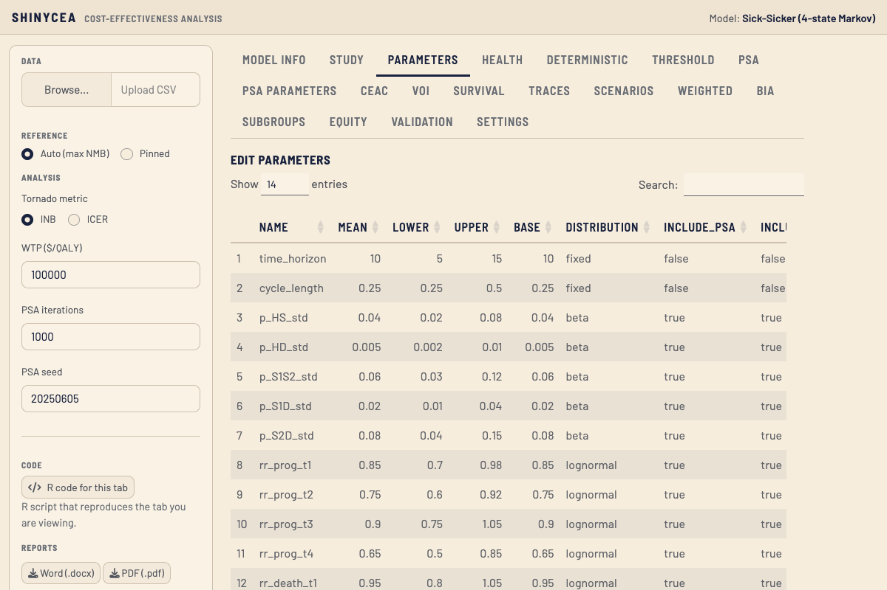
```

The **Health** tab checks the table for problems (for example a probability
above 1) and should show no FAIL before you continue.

## Step 3: Run the Base Case

Click **Run Deterministic**, then open **Deterministic**. The results table
lists each strategy's cost, QALYs and net monetary benefit (NMB), with the
increments and ICER against the reference. Here `t4` has the highest NMB at
a WTP of 100,000, so it is the reference and the preferred strategy.

```{r, echo = FALSE, fig.alt = "Deterministic tab: reference strategy, results table and frontier table"}
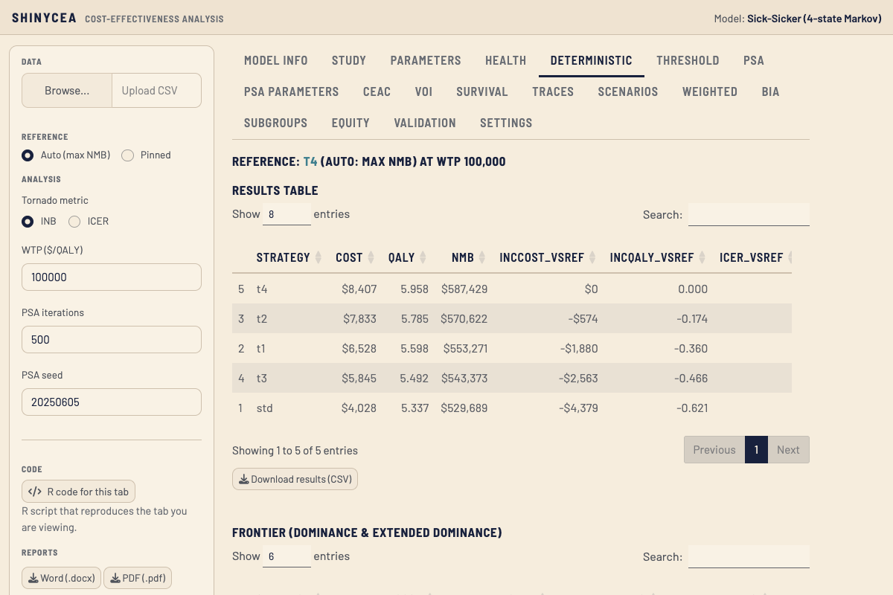
```

Further down the same tab:

- the **frontier** table and plot, which flag dominated and extendedly
  dominated strategies;
- the **tornado diagram**, which ranks parameters by how much they move the
  result for the target strategy you choose;
- the **two-way sensitivity analysis**, a heat map over two parameters.

```{r, echo = FALSE, out.width = "70%", fig.alt = "Tornado diagram of the incremental net benefit of std versus t4"}
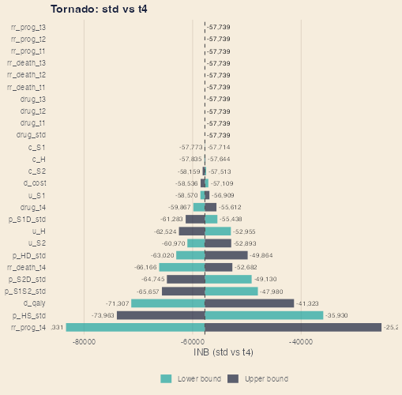
```

The **Threshold** tab searches for the value of one parameter at which the
ICER reaches the WTP: choose the strategy, the parameter and the range, then
click **Run threshold search**. **Survival** and **Traces** show the base-case
survival curves and the share of the cohort in each state over time:

```{r, echo = FALSE, fig.alt = "Traces tab: state occupancy over time for each strategy"}
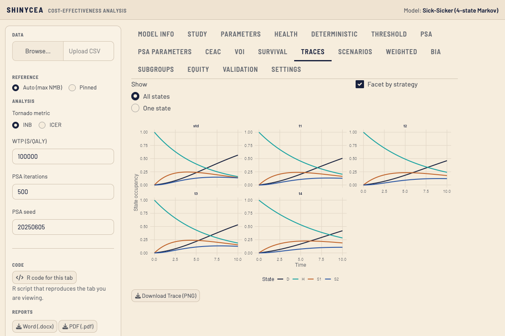
```

## Step 4: Run the Probabilistic Analysis

Set **PSA iterations** (1,000 or more for final results) and click **Run PSA**.
The **PSA** tab shows the cost-effectiveness plane, one point per iteration
and strategy relative to the reference, and a summary with 95% intervals.
**PSA Parameters** shows the distributions that were sampled.

```{r, echo = FALSE, fig.alt = "PSA tab: cost-effectiveness plane"}
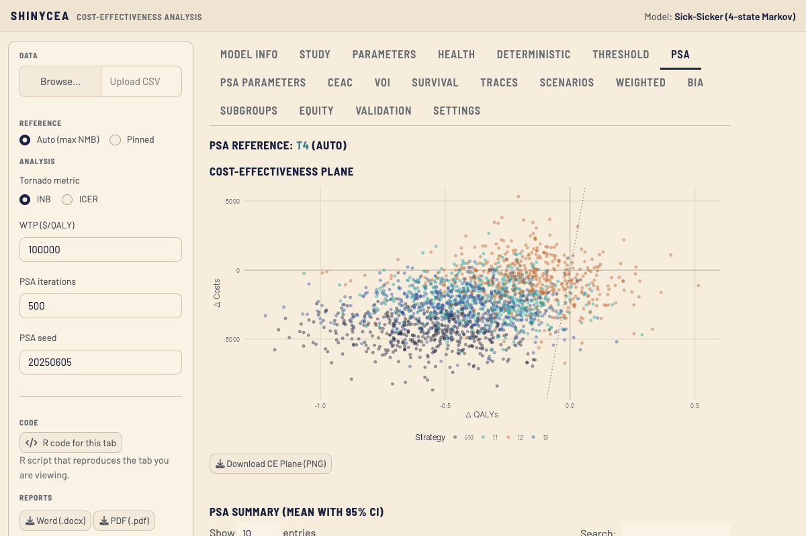
```

Open **CEAC** for the acceptability curves: the probability that each
strategy is cost-effective at each WTP. Tick **Superimpose the acceptability
frontier (CEAF)** to mark the strategy with the highest expected net benefit.

```{r, echo = FALSE, fig.alt = "CEAC tab with the acceptability frontier superimposed"}
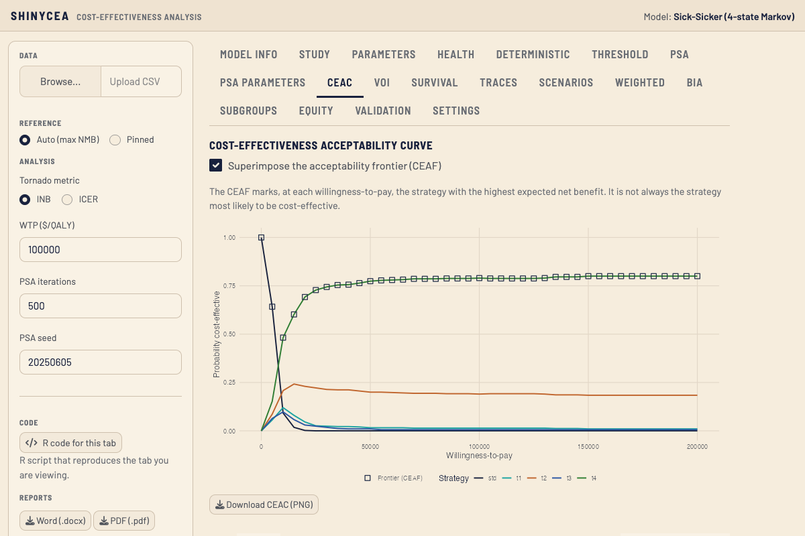
```

Below it, the **expected loss curves** show how much net benefit is forgone,
on average, by choosing each strategy. The lowest curve is the optimal
strategy, and its height is the EVPI.

```{r, echo = FALSE, out.width = "75%", fig.alt = "Expected loss curves with the optimal strategy marked"}
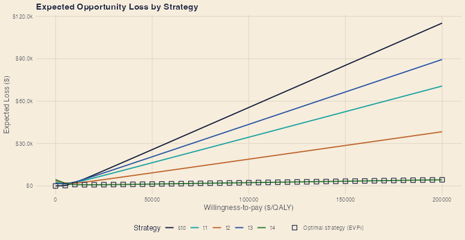
```

The **VOI** tab plots the EVPI across WTP values and the EVPPI, which ranks
parameters by the value of resolving their uncertainty:

```{r, echo = FALSE, out.width = "75%", fig.alt = "EVPPI by parameter"}
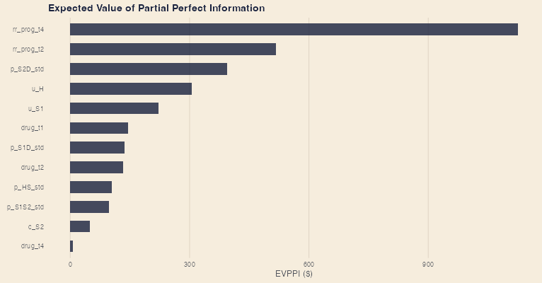
```

See `vignette("acceptability-expected-loss")` and
`vignette("value-of-information")` for how to read these figures.

## Step 5: Scenarios, Subgroups and Budget Impact

These tabs each have their own run button and do not need the PSA.

**Scenarios.** A scenario changes one or more parameter values. The
Sick-Sicker model comes with six (for example *No discounting*); add your own
with a name, a parameter and a new value. Click **Run all scenarios** to
compare results and see the optimal strategy in each.

```{r, echo = FALSE, fig.alt = "Scenarios tab after running: results for each scenario and strategy"}
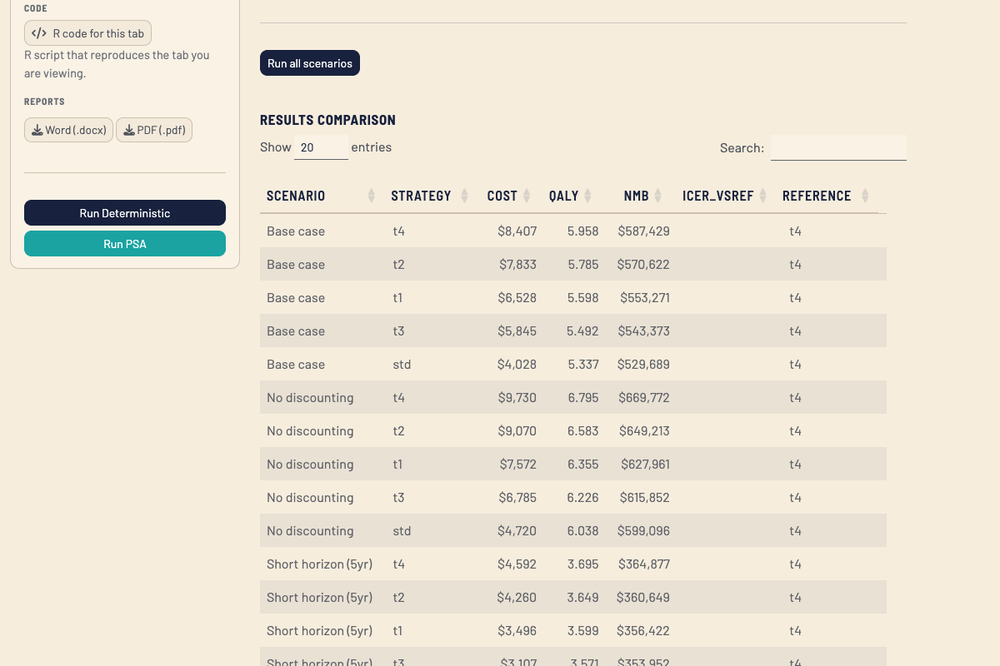
```

**Subgroups.** Works the same way for patient groups: choose a target and a
reference strategy, click **Run subgroup analysis**, and read the forest plot.

```{r, echo = FALSE, out.width = "75%", fig.alt = "Forest plot of the ICER of t1 versus std by subgroup"}
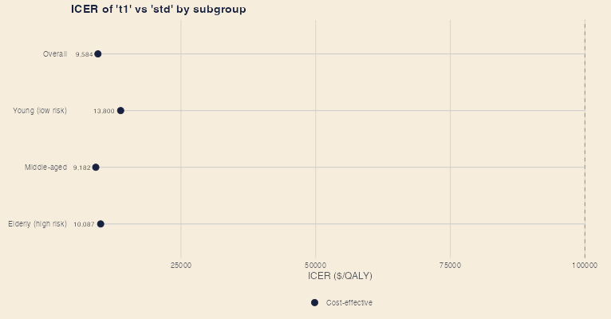
```

**BIA.** Enter the target population, the projection years, and the market
shares today and in the final year, then click **Run BIA** for the yearly and
total budget impact.

```{r, echo = FALSE, fig.alt = "BIA tab: population, projection years and market shares"}
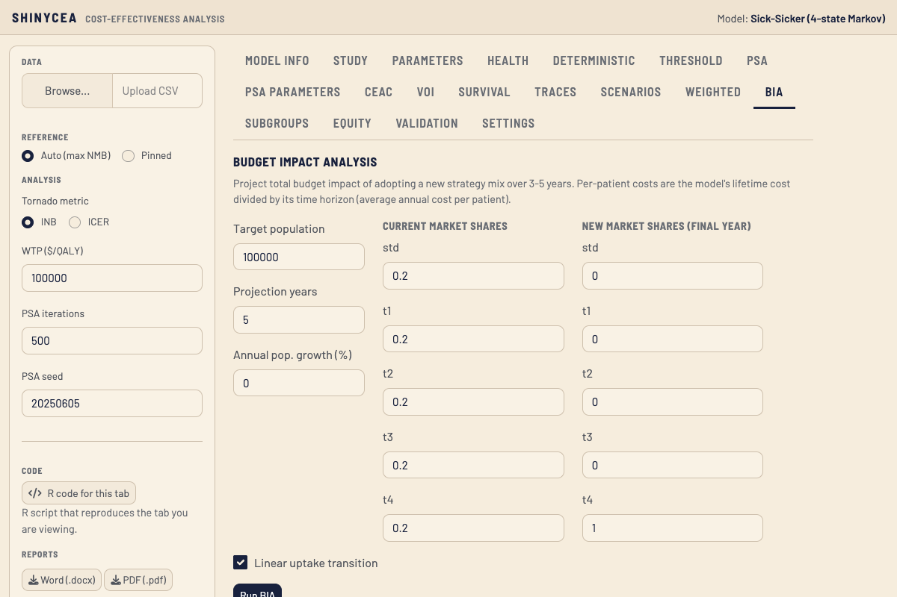
```

**Weighted** compares mixes of strategies, **Equity** shows how health gains
are distributed across the model's subgroups, and **Validation** runs a set of
automated checks and gives the model a score. Each works with one click on its
run button.

## Step 6: Describe the Study

Results need context to be interpreted. The **Study** tab holds the details a
reader expects: population, setting, perspective, a description of each
strategy, currency and price year, assumptions, funding. They come from the
model (see `cea_study()`) and can be completed here.

```{r, echo = FALSE, fig.alt = "Study tab: form with the study details"}
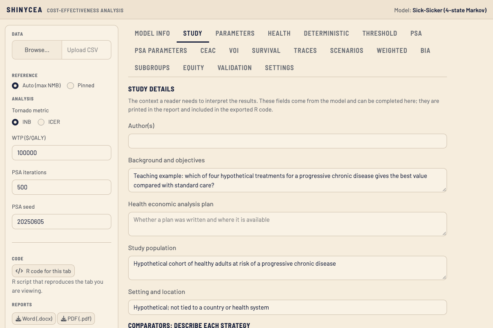
```

Below the form, the **CHEERS 2022 checklist** shows which reporting items are
covered by the study details, the parameter sources and the analyses you have
run, and what is still missing. It checks that information is present, not
that it is adequate. Items marked *Manuscript* (title, abstract, discussion)
are for you to write.

```{r, echo = FALSE, out.width = "70%", fig.alt = "CHEERS 2022 checklist with the status of each item"}
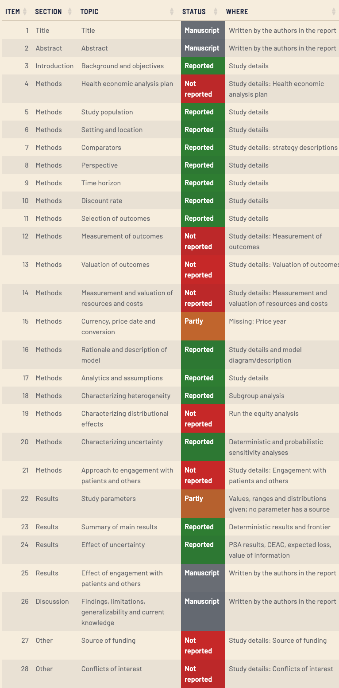
```

The Sick-Sicker example is filled with illustrative text and leaves some
fields empty on purpose, so you can see how an incomplete item looks.

## Step 7: Export the Code and a Report

Click **R code for this tab** on any tab to see the R script that reproduces
it with the values you selected. Choose **Full script (all tabs)** for the
whole analysis, then copy it or download it as an `.R` file. Because the
script uses the PSA seed from the sidebar, its results match the app.

```{r, echo = FALSE, fig.alt = "The R code window for the CEAC tab"}
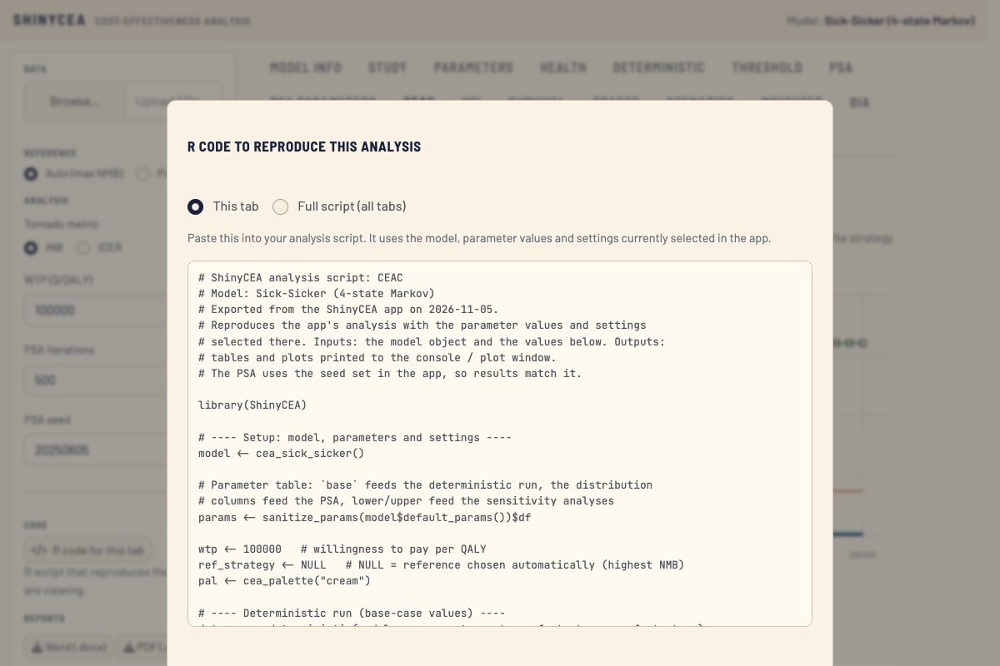
```

The exported script uses the same functions you can call yourself. The core
of the Sick-Sicker analysis is:

```{r script, eval = FALSE}
library(ShinyCEA)

model  <- cea_sick_sicker()
params <- sanitize_params(model$default_params())$df
wtp    <- 100000

# Base case
det <- run_deterministic(model, params, wtp = wtp)
det$table

# Probabilistic analysis, CEAC and expected loss
set.seed(20250605)
psa  <- run_psa(model, params, n_sim = 1000)
ceac <- compute_ceac(psa$results, det$strategies)
plot_ceac(ceac, ceaf = compute_ceaf(psa$results, det$strategies))
plot_expected_loss(compute_expected_loss(psa$results, det$strategies), show_optimal = TRUE)
```

The **Word** and **PDF** buttons under *Reports* build a document with the
study details, the model diagram, the tables and figures of the analyses you
have run, the parameter table with sources, and the CHEERS checklist. Every table and plot also
has its own download button, and **Settings** changes the colour palette of
all figures.

## A Typical Session

1. `run_cea_app(cea_sick_sicker())`
2. Check **Parameters** and **Health**; set WTP and the reference.
3. **Run Deterministic**: read the results, frontier and tornado.
4. **Run PSA**: read the CE plane, CEAC, expected loss and VOI.
5. Run **Scenarios**, **Subgroups** and **BIA** as needed.
6. Complete the **Study** details and check the CHEERS list.
7. Export the **R code** and a **report**.

If you change a parameter, the WTP, the reference or the seed after a run,
the app shows a banner saying the results are out of date: click the run
buttons again to refresh them.
